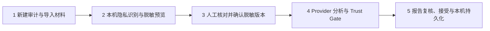
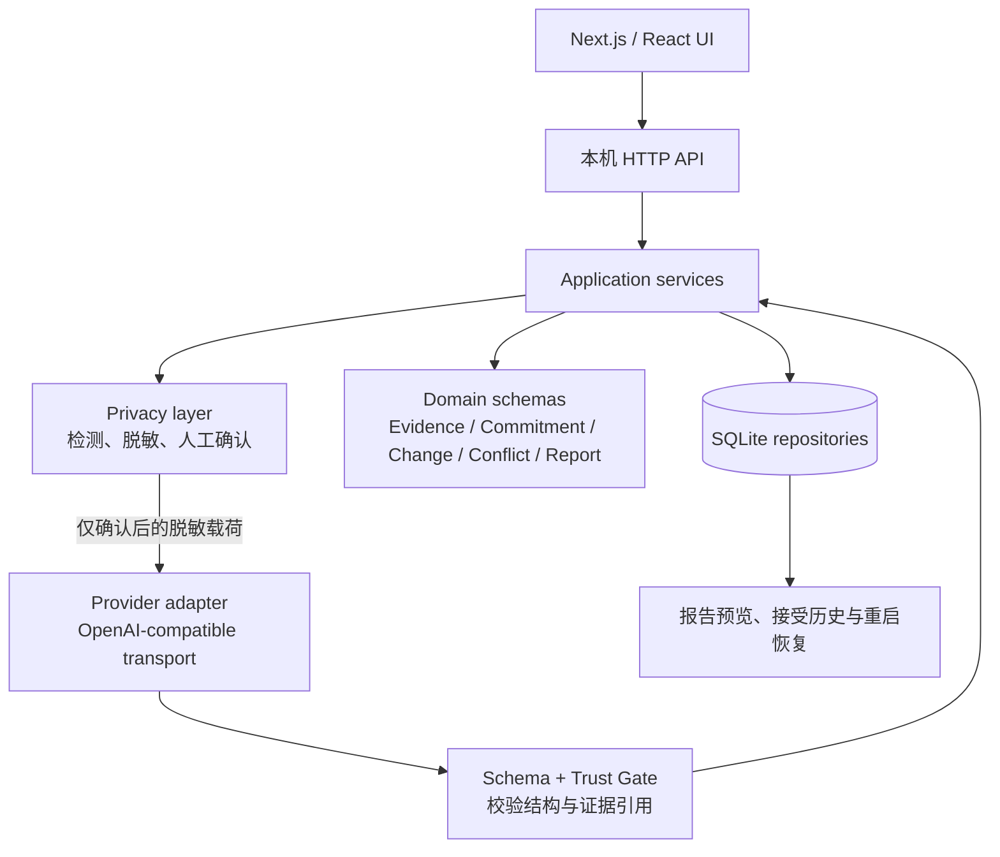

# 项目沟通与承诺审计智能体

> A local-first Windows app that turns project conversations into evidence-linked review reports.

这是面向 FDE、AI 应用工程与 AI 技术支持岗位的**原创源码展示仓库**。公开内容选自 R19 冻结 Source Authority，**不等于最新本机安装版的完整源码**。源码与部署成果对应表见 [`IMPLEMENTATION_STATUS.md`](IMPLEMENTATION_STATUS.md)。它展示一个本机优先的项目沟通审计应用，重点在隐私确认、结构化模型输出、证据引用校验、报告持久化和 Windows 本地运行边界。

**仓库状态：** curated source showcase。仓库不包含安装包、完整运行时、数据库、真实 Provider 配置或用户审计记录。源码公开供查看；当前没有授予复制、修改或再分发许可，也没有添加 MIT、Apache 等开源许可证。

## 一分钟了解

- 用户导入项目邮件、聊天或会议纪要后，先在本机检查敏感信息并核对脱敏结果。
- 只有用户明确确认脱敏版本并点击运行后，数据才会进入 Provider 分析流程。
- 模型返回的是结构化建议；本地 Schema、Trust Gate 和证据引用检查会校验输出。
- 报告把证据、承诺、变更、争议和未决事项分开展示，并要求人工复核及明确接受。
- Windows 单用户版本使用回环地址和 SQLite。报告保存与重启恢复已有本机工程验证。

## 五阶段工作流

数据外发由显式确认和运行操作控制。一次分析运行可包含多次 Provider 请求；审计结果不是法律意见或自动决策。

## 技术架构

分层和数据边界详见 [`docs/ARCHITECTURE.md`](docs/ARCHITECTURE.md)。实际代码入口可从 `src/privacy/`、`src/providers/`、`src/domain/`、`src/application/`、`src/db/`、`src/app/` 与 `src/components/` 阅读。

## 隐私与 Provider 接入

- 本仓库包含 R19 隐私检测、脱敏候选、映射修订、预览和人工确认流程；后续中文发言人姓名识别及遗漏姓名人工补标增强不在本仓库中，仅有本机验收证据。
- 预览、修订和确认由独立服务处理；确认版本与后续 Provider 请求绑定，旧确认不会静默覆盖新输入。
- 本仓库的 R19 Provider 适配器从运行环境读取配置，不保存实际 API Key。历史 R19 Windows 配置机制采用 ACL 保护的明文 JSON，但相关启动/配置辅助实现未纳入本仓库。后续正式本机版已经采用 Windows 当前用户 DPAPI 加密存储和 ACL 保护；DPAPI 辅助实现也未纳入本仓库。不要将历史机制描述理解为正式版仍明文保存凭证。
- Provider 输出需经过 Zod Schema 和引用一致性检查。不可验证的结构或不存在的 Evidence ID 不会被当作本地事实。
- 仓库内合成输入使用 `example.invalid` 保留域名；它不是实际客户或用户材料。

## 已有工程验证

以下结论来自历史及后续本机验收记录，不能视为所公开 R19 源码已包含全部后续功能；本次仓库整理没有运行 Provider、Build 或应用测试：

- 2026-10-22 的隔离真实 Provider E2E 记录为 1 次分析运行、4 次阶段请求、无自动重试；egress 边界通过，原始 prompt 和 raw response 未保存。报告生成、预览、接受与重启恢复通过，重启没有触发新分析。
- **仅本机验收证据，后续实现未公开：**2026-10-27 Build `X9GFOMJza7VdOASvVqMTB` 的报告 UX 部署验证通过：首屏指标、核心交付卡片、变更/争议区分、证据导航、历史报告保留、安全停止与重启恢复均通过。该轮 Provider 请求数为 0，Build 未重跑。
- 冻结 Source Authority 的 R19 manifest 共 252 个输入文件；当前正式源码逐文件 SHA-256 与 manifest 一致。

这些记录证明本机工程行为，不证明商业部署、企业客户使用量或线上生产规模。本仓库不携带原始验收包或屏幕截图，因为其与本机审计记录、绝对路径或无法在此仓库范围内独立确认的展示数据绑定。

## 已知限制

- Commitment 与 Conflict Domain 仍为 **PARTIAL**；AI 结果需要人工复核。
- 这是本机单用户应用，没有远程访问、多用户协作、企业客户商业交付或线上服务规模证明。
- 姓名或其他敏感信息检测可能漏检；人工检查仍是必要步骤。
- R19 历史明文 JSON 配置机制与后续正式版 DPAPI 存储属于不同版本；本仓库不包含两者的完整 Windows 启动/凭证辅助文件，也不包含任何真实配置。
- 完整第三方运行发行包的 `DEV08_A_LICENSE_GATE` 仍为 **BLOCKED**。这里不分发第三方运行代码、`node_modules`、`.next` 或 Windows Runtime。
- 本仓库未包含完整依赖锁定、迁移及构建/运行辅助文件，不能开箱即用，也不承诺完整可复现的安装版。

## 求职能力与项目职责

本项目展示需求拆解、流程设计、LLM API 适配、结构化输出校验、隐私与人工确认边界、SQLite 生命周期、Windows 本地部署、回归验收 Gate 和缺陷迭代。项目由项目负责人推动，开发过程中使用 Codex 辅助分析、实现和核验；不声称全部代码由本人逐行手写。

## 目录

- `src/`：R19 冻结源码中的应用、领域、隐私、Provider、存储、API 与 UI 精选实现；不包含后续安装版全部修改。
- `tests/`：经过本次范围筛选的工程测试代码。含合成凭证标记、手机号样式数字或本机路径样例的若干测试未进入公开文件清单，以避免静态扫描将测试哨兵误认为真实凭证或个人数据。
- `examples/synthetic-conversation.txt`：不包含实际用户数据的合成输入样例。
- `docs/ARCHITECTURE.md`：工作流、组件与数据流说明。
- `docs/SECURITY_EXCLUSIONS.md`：公开范围的排除清单。

## English summary

A curated, source-only showcase selected from the frozen R19 source baseline, distinct from the latest installed app, of a local-first Windows application for reviewing project conversations. It demonstrates human-confirmed redaction, structured provider integration, evidence-reference validation, report acceptance, and SQLite recovery. This repository is for viewing only: it has no open-source license, contains no app binary or third-party runtime, and does not represent a supported build or commercial deployment.

