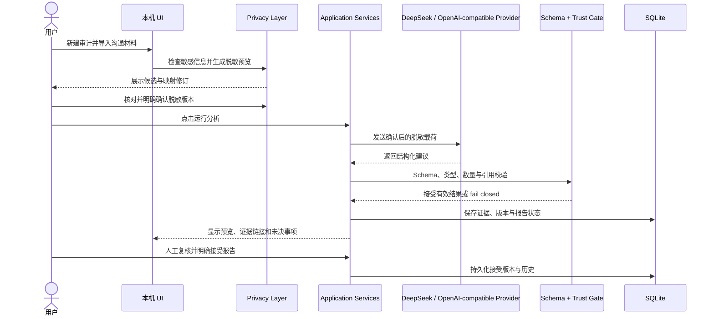

# 架构与数据边界

本图描述 R19 源码展示的分层。后续姓名增强、只读质量复核和最终报告 UX、正式版 DPAPI 辅助实现未全部纳入本仓库；对应关系见 [`IMPLEMENTATION_STATUS.md`](../IMPLEMENTATION_STATUS.md)。

## 五阶段流程

## 组件边界

| 层 | 位置 | 责任 |
| --- | --- | --- |
| UI / HTTP | `src/app/`, `src/components/`, `src/server/` | 本机交互、输入边界、错误映射与路由 |
| Application | `src/application/` | 审计、隐私确认、运行编排、报告读取和接受 |
| Privacy | `src/privacy/` | 检测、脱敏、候选映射、人工修订、确认版本和 egress gate |
| Provider | `src/providers/` | OpenAI-compatible transport、阶段调用、运行诊断和结构化响应信任校验 |
| Domain | `src/domain/` | Evidence、Commitment、Change、Conflict 与 Report 的 schema 和不变量 |
| Persistence | `src/db/` | SQLite schema、连接生命周期和 repositories |

## 保护边界

1. 源材料先在本机处理。检查结果不是向 Provider 发送的授权。
2. 外发需要用户确认脱敏结果并主动运行分析。
3. API Key 从本机配置注入；本仓库不包含配置值或 DPAPI 文件。
4. Provider 输出是候选信息，必须符合 schema，并且 Evidence 引用必须解析到当前报告版本的本地证据。
5. 报告需要人工阅读并主动接受。记录的类别不等于已证实事实；未决项和证据不足会保留。
6. 正式运行数据库位于本机用户数据目录。本仓库完全不包含 SQLite 文件或其备份。

## 运行边界

已验收 Windows x64 版本仅绑定 `127.0.0.1:43127`，面向单用户。本仓库没有完整依赖安装材料、`.next`、Standalone 输出、Node Runtime 或 Windows 安装程序，因此不是可构建发行包。
